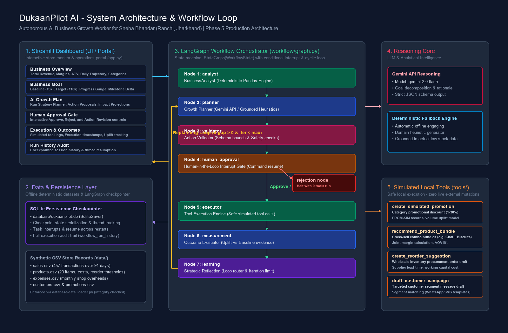
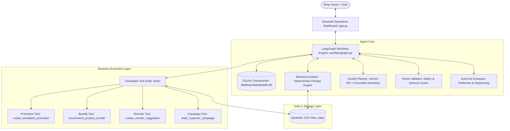
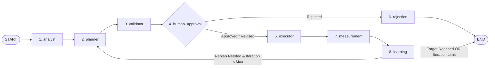
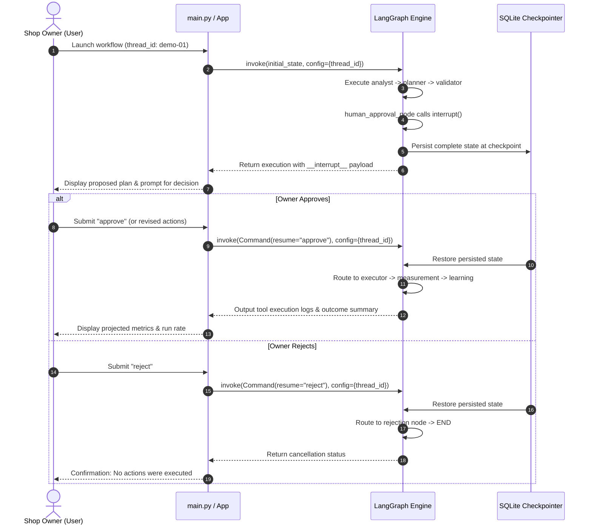

# DukaanPilot AI: System Architecture

## 1. System Overview

DukaanPilot AI is an autonomous business growth agent designed for micro-retailers. The system orchestrates an iterative feedback loop: analyzing business data, planning high-impact interventions, requesting human authorization for sensitive operations, executing simulated business tools, measuring financial outcomes, and adapting its strategy until a specific business goal is met.

The primary target scenario is elevating **Sneha Bhandar**, a neighborhood retail shop in **Shiv Shakti Nagar, Booty More, Ranchi, Jharkhand (834009)**, from a monthly baseline revenue of **₹8,000** to **₹10,000**.

---

## 2. Component Architecture

---

## 3. LangGraph Workflow Node & Edge Flow

The workflow is modeled as a stateful cyclic directed graph using `StateGraph(WorkflowState)`:

### Detailed Node Responsibilities:

1. **`analyst` (`analyst_node`):**
   - Ingests verified synthetic datasets from `data/` via `database.data_loader`.
   - Computes deterministic historical KPIs using `agents.business_analyst.BusinessAnalyst` (monthly revenue, COGS, margins, basket value, stock deficits).
   - Never hallucinates figures or delegates arithmetic to an LLM.

2. **`planner` (`planner_node`):**
   - Synthesizes analyst findings, stock alerts, and growth gap.
   - Leverages the Gemini API (with deterministic fallback) to generate 3–5 practical actions.
   - Formulates concrete parameters, business rationale, labeled estimated impacts, costs, risks, and success metrics.
   - Increments the loop `iteration_count`.

3. **`validator` (`validator_node`):**
   - Verifies each action against registered tool schemas (`tools.registry.TOOL_SCHEMAS`).
   - Rejects actions missing parameters, exceeding safety boundaries (e.g., discounts >30%), or omitting explicit estimation labeling.
   - Partitions actions into valid and rejected pools.

4. **`human_approval` (`human_approval_node`):**
   - Uses LangGraph's native `interrupt()` function to halt execution before tool invocation.
   - Surfaces proposed actions to the shop owner with expected impact and costs.
   - Receives human decision (`approve`, `reject`, or customized action revisions).
   - Routes to `executor` if approved, or `rejection` if declined.

5. **`executor` (`executor_node`):**
   - Invokes local demonstration tools via `tools.registry.execute_action`.
   - Captures tool returns and intercepts parameter or runtime errors gracefully without aborting the graph.

6. **`measurement` (`measurement_node`):**
   - Evaluates executed tool impacts against historical baseline metrics.
   - Distinguishes verified historical figures from projected simulated revenue uplifts.

7. **`learning` (`learning_node`):**
   - Evaluates whether the growth gap is closed or if tool errors necessitate strategy revision.
   - Checks guardrail: if `iteration_count < max_iterations`, routes back to `planner` for replanning; otherwise concludes gracefully.

8. **`rejection` (`rejection_node`):**
   - Logs plan rejection and terminates the run cleanly without executing tools.

---

## 4. Human Approval Interrupt & Resume Sequence

---

## 5. Persistence and Recovery

* **Checkpoint Store:** Built using `SqliteSaver` pointing to `database/dukaanpilot.db`.
* **Stable Thread ID:** Workflows are addressed by unique thread IDs (e.g., `demo-sneha-session-01`).
* **Durability:** The workflow state can be interrupted, the terminal closed, or the machine restarted. Re-invoking the graph with the same thread ID resumes execution from the exact saved checkpoint.

---

## 6. Demonstration Tool Suite (`tools/`)

All tools are local, safe simulations operating strictly on project data:

| Tool | Implementation | Function |
| :--- | :--- | :--- |
| `create_simulated_promotion` | `tools/promotion_tool.py` | Schedules category-level discount records with volume uplift projections. |
| `recommend_product_bundle` | `tools/bundle_tool.py` | Calculates cross-sell combo pricing, customer savings, and merchant margins. |
| `create_reorder_suggestion` | `tools/reorder_tool.py` | Generates procurement purchase orders for low-stock items (averting stockout risks). |
| `draft_customer_campaign` | `tools/campaign_tool.py` | Drafts targeted customer segment broadcasts (e.g. WhatsApp weekend specials). |

---

## 7. Safety and Ethical Boundaries

* **No Real Transactions:** No real banking, payment gateways, or financial ledger modifications occur.
* **No Real Outreach:** No real SMS, emails, or WhatsApp messages are transmitted.
* **Explicit Labeling:** All LLM outputs and tool projections are labeled as estimates.
* **Deterministic Metrics:** All business mathematics, profits, and margins are computed exclusively via Python and Pandas.
