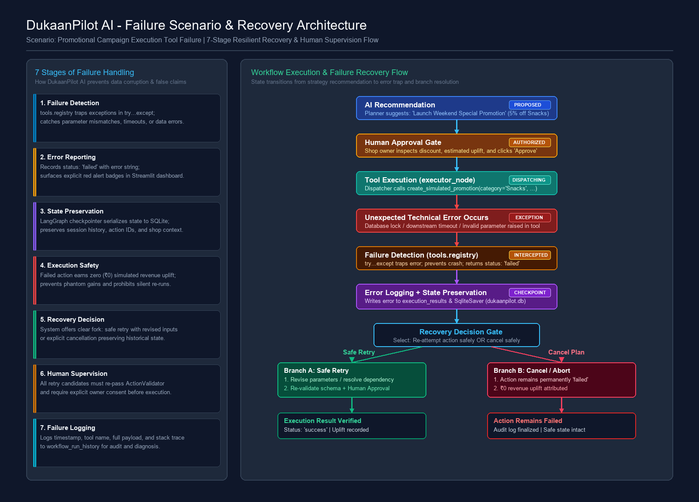
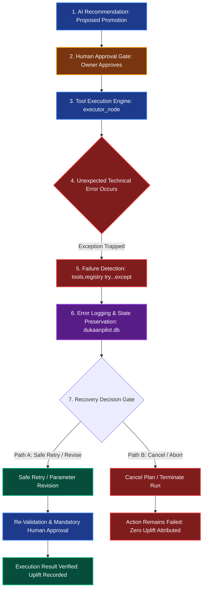

# Technical Note: DukaanPilot AI

**System Design, Architectural Principles, and Implementation Analysis**

---

## 1. Problem and Project Objective

Micro-retailers in India—such as neighborhood *kirana* stores—face structural operating disadvantages:
1. **Thin Operating Margins:** Store owners juggle inventory purchasing, cash management, customer credit (*khata*), and storefront service simultaneously, leaving little time for data-driven strategic planning.
2. **Suboptimal Working Capital Allocation:** Fast-moving consumer goods (FMCG) often suffer from localized stockouts, while slow-moving discretionary goods trap working capital on shelves.
3. **Absence of Domain-Specific Analytics:** While enterprise retailers use sophisticated ERPs and merchandising engines, neighborhood shop owners have access only to passive digital ledgers or manual notebooks.

**Project Objective:**
To construct an autonomous, closed-loop **AI Business Growth Worker** that operates within a safe simulated testing boundary for **Sneha Bhandar** (Shiv Shakti Nagar, Booty More, Ranchi, Jharkhand – 834009). The worker analyzes daily transaction ledgers, formulates actionable growth interventions, enforces human-in-the-loop authorization gates, executes simulated operational tools, measures financial uplift against empirical baselines, and dynamically replans toward a milestone monthly revenue target (increasing from baseline **₹8,000** to target **₹10,000**).

---

## 2. Why an Autonomous AI Worker Rather Than a Simple Chatbot?

Traditional conversational bots (e.g., standard ChatGPT or generic Q&A interfaces) suffer from fundamental architectural deficiencies when applied to business operations:

| Feature | Conventional Chatbot | DukaanPilot AI Worker |
| :--- | :--- | :--- |
| **Interaction Paradigm** | Passive request-response; waits for human prompts. | Goal-directed autonomous loop; drives tasks forward. |
| **Data Processing** | Delegates arithmetic to LLM (frequent hallucinations). | Deterministic Pandas engine; 100% verified arithmetic. |
| **Action Execution** | Emits markdown advice; cannot execute actions. | Dispatches schema-validated tools with structured outputs. |
| **State Persistence** | Ephemeral context window; resets on reload. | SQLite-backed checkpoints; resumes interrupted workflows. |
| **Safety Architecture** | Weak system-prompt warnings ("please be careful"). | Hard interrupt gates; execution strictly blocked without user consent. |
| **Feedback Loop** | Open-loop; no verification of recommendations. | Closed-loop; measures simulated uplift and replans adaptively. |

DukaanPilot AI is designed not as a conversational advisor, but as an **operational co-worker** that executes concrete tasks while keeping the business owner firmly in command.

---

## 3. System Architecture and Technology Choices

DukaanPilot AI adheres to a modular, layered architecture:

```
[ Presentation Layer: Streamlit + Plotly (app.py) ]
                        │
                        ▼
[ Workflow Engine: LangGraph State Machine (workflow/graph.py) ]
        │                   │                   │
        ▼                   ▼                   ▼
[ Data Analytics ]   [ Reasoning Core ]   [ Execution Suite ]
  BusinessAnalyst      Gemini 2.0 Flash     4 Local Tools
  Pandas (verified)    Structured JSON      Safe Simulations
        │                   │                   │
        └───────────────────┼───────────────────┘
                            ▼
[ Persistence & State Store: SQLite Checkpointer (dukaanpilot.db) ]
```

### Technology Selections & Rationale:
- **LangGraph:** Provides cyclic graph topologies with native execution interrupts (`interrupt()`) and checkpoint serialization (`SqliteSaver`), enabling pause-and-resume workflows.
- **Python & Pandas:** Ensures that all revenue, cost of goods sold (COGS), gross margins, inventory deficits, and basket sizes are calculated deterministically. LLMs are never allowed to perform financial arithmetic.
- **Google Gemini API (`gemini-2.0-flash`):** High-speed, cost-effective reasoning for strategic problem decomposition with strict JSON schema compliance.
- **SQLite:** Serverless, portable, embedded relational database for zero-overhead local deployment, checkpointing, and execution history.
- **Streamlit & Plotly:** Rapid, reactive user interface for interactive data exploration, chart rendering, and decision gates.

---

## 4. Agent Workflow and State Management

The workflow is modeled as a state machine (`StateGraph(WorkflowState)`) containing 8 distinct nodes:

1. **`analyst` (`analyst_node`):**
   Loads synthetic records (`data/sales.csv`, `products.csv`, `expenses.csv`), computes financial totals, margins, stock deficits, and growth gaps.
2. **`planner` (`planner_node`):**
   Synthesizes diagnostic metrics and business objectives, calling the Gemini API to formulate 3–5 candidate growth interventions.
3. **`validator` (`validator_node`):**
   Filters proposed actions against registered tool schemas, checking parameter bounds and enforcing mandatory estimation labels.
4. **`human_approval` (`human_approval_node`):**
   Pauses execution using LangGraph's `interrupt()` primitive. Surfaces actions and projected impacts to the user.
5. **`executor` (`executor_node`):**
   Dispatches authorized actions to local demonstration tools, capturing timestamps, status codes, and execution payloads.
6. **`measurement` (`measurement_node`):**
   Calculates simulated monthly revenue uplift, compares projected run rates against the ₹10,000 target, and computes the remaining financial gap.
7. **`learning` (`learning_node`):**
   Evaluates target achievement and tool execution health. If the target is not reached and `iteration_count < max_iterations`, routes back to `planner`; otherwise concludes.
8. **`rejection` (`rejection_node`):**
   Terminal node reached when an owner declines a plan. Halts execution immediately with zero tool invocations.

### State Schema (`WorkflowState`):
Key state variables include:
- `business_context`: Shop identity and location parameters.
- `business_metrics`: Verified financial outputs from `BusinessAnalyst`.
- `business_goal`: Baseline, target, and milestone figures.
- `proposed_actions` / `approved_actions`: Intervention lists.
- `validation_results`: Schema and constraint audit logs.
- `approval_status`: `'pending'`, `'approved'`, or `'rejected'`.
- `execution_results`: Array of tool return dictionaries with timestamps.
- `measured_outcomes`: Post-execution financial uplift calculations.
- `iteration_count` / `max_iterations`: Loop control guardrails.

---

## 5. Human Approval and Safety Controls

To protect retail operations, DukaanPilot AI enforces a strict **Human-in-the-Loop (HITL)** architecture:

1. **Execution Freeze via `interrupt()`:**
   The workflow cannot transition from planning/validation to execution without human authorization. The graph pauses, serializing all intermediate node outputs to SQLite.
2. **Explicit Decision Primitives:**
   - **Approve:** Resumes graph via `Command(resume="approve")`, executing all validated actions.
   - **Reject:** Resumes graph via `Command(resume="reject")`, immediately routing to `rejection` node. Zero tools are executed.
   - **Revise:** Resumes graph via `Command(resume={"decision": "revise", "actions": [...]})`. Selected actions are automatically re-validated through `validate_proposed_plan()` before execution.
3. **Safety Policies Enforced in Validation:**
   - **Discount Ceiling:** Promotional discounts exceeding 30% are automatically rejected to preserve store gross margin.
   - **Schema Compliance:** Actions specifying unregistered tools or missing mandatory parameters fail validation.
   - **Estimation Labeling Policy:** Any expected impact claim lacking explicit estimation qualifiers (e.g., "Estimated impact:", "projected") is rejected to prevent deceptive certainty.

---

## 6. Tool Execution Design

All actions are mapped to registered, offline demonstration tools (`tools/`):

1. **`create_simulated_promotion`:** Models category discount schedules (1–30%), projecting volume elasticity and gross margin impacts.
2. **`recommend_product_bundle`:** Formulates cross-selling pairs (e.g., Red Label Tea 250g paired with Parle-G 250g) to increase average transaction value (ATV).
3. **`create_reorder_suggestion`:** Formulates wholesale replenishment drafts for items below reorder thresholds (e.g., Britannia Bread, MDH Deggi Mirch), estimating procurement working capital.
4. **`draft_customer_campaign`:** Synthesizes localized customer communication templates for specific shopper segments (e.g., Weekly Family Shoppers).

### Resilient Error Recovery:
The dispatcher (`tools.registry.execute_action`) wraps each tool in structured exception handlers. If a tool fails (e.g., invalid product ID), it returns a structured failure dictionary (`status: "failed"`, `error: "..."`). The executor records the error in `execution_results` and continues executing remaining valid tools without crashing the workflow.

---

## 7. Failure Scenario and Recovery Strategy

In micro-retail automation, an autonomous AI worker must handle unexpected operational and technical failures gracefully. Fragile scripts that crash or—worse—falsely claim success can corrupt business ledgers, order incorrect stock, or mislead store owners regarding their financial standing.

### Scenario: Business Tool Execution Failure

**Operational Context:**
DukaanPilot AI analyzes 91 days of historical store records for **Sneha Bhandar** (Shiv Shakti Nagar, Booty More, Ranchi). Observing that packaged snacks and beverages exhibit high customer traffic but sub-optimal basket sizes, the Growth Planner (`planner_node`) recommends launching a **"Weekend Family Snack Special"** promotion (a 5% category discount on snacks, projecting an estimated monthly revenue uplift of +₹350 with zero upfront marketing cost).

The shopkeeper reviews the recommendation via the Streamlit dashboard or AI Voice Briefing and clicks **"Approve"**.

The LangGraph engine transitions from the `human_approval` gate to `executor_node`. However, upon dispatching `create_simulated_promotion(promotion_name="Weekend Snack Special", category="Snacks", discount_percentage=5)`, the simulated business tool encounters an **unexpected technical error** (e.g., downstream repository timeout, catalog key mismatch, file system lock, or parameter serialization fault).

### The 7 Stages of Resilient Failure Handling:

1. **Failure Detection:**
   The tool dispatcher (`tools.registry.execute_action`) encapsulates every tool call within a structured `try...except Exception as exc:` barrier. Rather than permitting an unhandled exception to propagate up the stack and terminate the LangGraph runtime, the failure is intercepted at the boundary. The dispatcher constructs an explicit failure payload:
   ```python
   {
       "status": "failed",
       "tool": "create_simulated_promotion",
       "error": "Database lock timeout: Unable to commit promotion record to store repository.",
       "parameters": {"promotion_name": "Weekend Snack Special", "category": "Snacks", "discount_percentage": 5}
   }
   ```
   Invalid tool names or parameter schema violations are similarly caught before invocation.

2. **Error Reporting:**
   The system never masks an error or claims false completion. The `executor_node` captures the failure payload and appends an explicit record to `WorkflowState["execution_results"]`:
   - `action_id`: Unique identifier of the attempted action.
   - `status`: `"failed"`.
   - `executed_at`: Timestamp of the failure event.
   - `error`: Full diagnostic error string.
   
   In the user interface (`app.py`), the failure is rendered prominently with an amber/red warning badge (`🚨 FAILED`), ensuring the shopkeeper immediately understands that the action did not execute.

3. **State Preservation:**
   The workflow leverages LangGraph's native SQLite checkpointer (`SqliteSaver` in `database/dukaanpilot.db`). At every node transition, the full `WorkflowState`—including original business metrics, proposed interventions, validation audit logs, human approval tokens, and partial execution results—is committed to disk. If the server terminates, the browser closes, or power fails, the entire session state is safely restored from the thread checkpoint (`thread_id`), preventing state corruption or data loss.

4. **Execution Safety & Zero Phantom Uplift:**
   The failed action is strictly marked as `status: "failed"` and is **never** marked as completed. To ensure financial truthfulness, `workflow/evaluator.py` (`measure_execution_outcomes`) partitions execution results:
   ```python
   successful_runs = [r for r in exec_results if r.get("status") == "success"]
   failed_runs = [r for r in exec_results if r.get("status") == "failed"]
   ```
   Only `successful_runs` contribute to `total_simulated_revenue_uplift_inr`. The failed promotional campaign contributes exactly **₹0.00** to simulated uplift. The system never fabricates phantom revenue gains. Furthermore, independent actions in the same batch (e.g., a low-stock reorder suggestion) continue to execute independently; one failed tool does not abort or corrupt unrelated valid operations.

5. **Recovery Decision & Strategy:**
   Following execution, the `learning_node` (`workflow/evaluator.py`) evaluates overall run health. If `failed_actions_count > 0`, the reflection engine sets:
   - `should_replan = True`
   - `decision_reason = f"{failed_count} action(s) experienced execution failures. Replanning necessary to adjust parameters."`
   
   If loop limits allow (`iteration_count < max_iterations`), the graph routes back to the planner to formulate alternative actions. In the dashboard, the shopkeeper is offered two clear recovery paths:
   - **Safe Retry / Revision:** Select the failed action under the "Revise / Choose Specific Actions" panel, adjust parameters (e.g., alter the category or timing), and re-submit.
   - **Safe Cancellation:** Leave the failed action unexecuted; the workflow terminates cleanly, preserving audit logs without retrying corrupted commands.

6. **Human Supervision:**
   Automated retries that alter retail operational state without human oversight are strictly prohibited. Any retried, modified, or alternative intervention generated after a failure must re-enter the standard lifecycle:
   - Must pass `ActionValidator` (`agents/action_validator.py`) for schema validity and discount ceilings (≤30%).
   - Must pause at the `human_approval` gate via LangGraph's `interrupt()` primitive.
   - Must receive explicit merchant authorization (`approve` or `revise`) before the worker touches any execution tool.

7. **Failure Logging & Audit Trail:**
   Every failure event is permanently recorded in the system audit trail:
   - Recorded in `WorkflowState["execution_results"]` with timestamp, parameters, and error trace.
   - Saved in the SQLite `workflow_run_history` table (recording thread ID, run duration, action counts, failure count, and summary).
   - Readily inspectable in the **Run History Audit** dashboard tab for debugging, compliance, and operational post-mortems.

---

### Failure Recovery Flow Diagram

The diagram below illustrates the complete sequence from initial proposal through failure detection, state preservation, recovery decision, and human-supervised resolution:





---

### Failure Handling Evaluation Table

The following evaluation matrix details how DukaanPilot AI addresses primary system failure modes:

| Failure Condition | Expected Worker Behaviour | Safety Mechanism | Recovery Approach |
| :--- | :--- | :--- | :--- |
| **Tool Execution Failure** *(e.g., downstream timeout, I/O lock, catalog key mismatch)* | Intercept exception at tool boundary; set status to `"failed"`; record diagnostic error; attribute ₹0 uplift; continue executing unaffected batch actions. | `try...except` isolation in `tools.registry.execute_action`; schema validation bounds; zero-uplift filter in `workflow/evaluator.py`. | Isolate failed action; log details to SQLite; reflect in `learning_node`; allow owner to revise parameters and re-approve via dashboard. |
| **Missing or Invalid Business Data** *(e.g., absent CSV file, NaN prices, corrupt ledger)* | Halt data ingestion before analytical processing; prevent corrupted data from reaching the LLM or tool execution engine; alert user. | `database.data_loader.validate_data_integrity()` enforces required files, primary key uniqueness, positive pricing, and non-empty rows. | Report specific missing file or schema breach; fall back to verified default synthetic dataset; generate diagnostic error logs. |
| **Gemini API Unavailable** *(e.g., network timeout, quota exceeded, invalid API key)* | Formulate grounded, actionable growth strategies without crashing, hanging, or requiring internet connectivity. | Heuristic data-grounded fallback generator in `agents.growth_planner.generate_fallback_plan()`; structured JSON parsing guards. | Automatically switch to deterministic rule-based recommendations; tag plan with `planner_source: "heuristic_fallback"`; alert user. |
| **Interrupted Workflow** *(e.g., browser tab closed, server restart, power outage mid-session)* | Retain exact state snapshot and pending interrupts; avoid duplicate executions or restarting data analysis from scratch. | LangGraph `SqliteSaver` checkpointer serializes complete `WorkflowState` to `database/dukaanpilot.db` after each node transition. | Re-open session with identical `thread_id`; `app.get_state()` reconstructs state and pending `__interrupt__` payload for seamless resumption. |
| **Duplicate Execution Attempt** *(e.g., repeated button clicks, page refresh, double POST)* | Execute approved actions exactly once; ignore redundant clicks; prevent duplicate tool dispatch or duplicate discount applications. | Idempotent thread IDs; state-level execution tracking (`workflow_status: "executed"`); Streamlit one-shot button triggers. | Inspect persisted state before tool dispatch; if status is already `"executed"`, return cached execution records without re-running tools. |

---

---

## 8. Evaluation Approach and Measurable Success Criteria

DukaanPilot AI establishes clear, quantitative benchmarks:

1. **Analytical Accuracy:** 100% agreement between dashboard metrics and manual arithmetic proofs across 91 days of transactions.
2. **Safety Enforcement:** 100% rejection rate for discount actions >30% and 0 tool executions when a plan is rejected.
3. **Test Suite Coverage:** 66+ automated tests spanning unit arithmetic, action validation, graph execution, state restoration, Sarvam AI speech synthesis, bilingual voice reporting, and failure recovery.
4. **Milestone Tracking:** Clear measurement of monthly revenue trajectory toward the ₹10,000 target:
   - Historical Baseline: ₹8,061.67 / month
   - Simulated Monthly Uplift: +₹960.00 / month (approx. 12% revenue expansion)
   - Projected New Run Rate: ₹9,021.67 / month
   - Remaining Projected Gap: ₹978.33 / month

---

## 9. AI Voice Business Briefing (Sarvam AI Integration)

To bridge the literacy and digital divide for small shopkeepers, DukaanPilot AI integrates an **AI Voice Business Briefing** powered by **Sarvam AI Text-to-Speech**:

1. **Bilingual Structured Briefing:** Generates a comprehensive 9-section report in both English and everyday natural Hindi, covering sales totals, target pacing, stockout risks, slow-moving inventory, customer visit profiles, opportunities, and AI-recommended actions.
2. **Sarvam AI Speech Engine:** Connects to `https://api.sarvam.ai/text-to-speech` using Indian voices (`ritu` for Hindi and `priya` for English).
3. **Chunking & Caching Pipeline:** Splits long reports into sentence-aligned chunks (<1500 characters) to adhere to API constraints, while computing deterministic SHA-256 audio cache keys to eliminate redundant API billing and latency.
4. **Resilient Offline Fallback:** If Sarvam AI credentials are unset or the network fails, the written bilingual report remains completely readable, and action authorization remains fully accessible.
5. **Decoupled Approval:** Listening to the voice briefing does not auto-execute actions; shopkeepers must explicitly click Approve, Reject, or Revise to resume the LangGraph workflow.

---

## 10. System Limitations and Future Improvements

To maintain rigorous technical honesty and academic integrity, the system explicitly distinguishes between **currently implemented capabilities** verified in our automated test suite and **proposed future improvements** designed for production scaling.

### Existing Implemented Capabilities (Verified in Test Suite):
- **Structured Exception Capture:** The dispatcher (`tools/registry.py`) wraps all tool invocations in `try...except Exception`, capturing errors, preventing unhandled runtime crashes, and returning structured failure payloads (`status: "failed"`).
- **Zero Phantom Uplift Attribution:** The evaluation engine (`workflow/evaluator.py`) partitions executed tools, ensuring failed actions contribute exactly ₹0 to simulated revenue uplift and increment `failed_actions_count`.
- **Stateful SQLite Checkpointing:** Every node transition is checkpointed to `database/dukaanpilot.db` via LangGraph's `SqliteSaver`, allowing recovery across restarts without re-running data ingestion.
- **Deterministic Heuristic Fallback:** When the Gemini API is unreachable, times out, or returns non-compliant schemas, the system transparently falls back to `generate_fallback_plan()`, maintaining full offline operability.
- **Mandatory Re-Validation on Revision:** When a user customizes or retries actions, the revised plan is passed through `validate_proposed_plan()` before execution, re-verifying parameter bounds and discount ceilings.
- **Transparent Status Surfacing:** The Streamlit dashboard renders explicit status badges (`🚨 FAILED`), action diagnostics, and audit logs without masking errors.

### Honest Limitations & Disclosures:
- **No Automated In-Graph Retries Currently Implemented:** The current implementation halts execution of a failed action and surfaces it to the shopkeeper rather than executing automatic blind retries in a background loop.
- **No Transactional Rollback Mechanisms:** Because all current tools operate in a safe offline simulation environment, complex transactional rollbacks (e.g., compensating two-phase commits) are not implemented.
- **Synthetic Simulation Boundaries:** All customer records, sales transactions, and supplier orders are synthetic. No live SMS/WhatsApp messages, physical inventory shipments, or banking transactions occur.
- **Single Shop Focus:** Configuration parameters and catalog schemas are tailored to the retail profile of Sneha Bhandar (Ranchi).

### Proposed Future Improvements & Architecture Roadmap:

1. **Automatic Retry with Controlled Limits (Exponential Backoff):**
   - Implement an automated retry policy for transient tool and API faults (e.g., maximum 3 retries with jittered exponential backoff: $t_{wait} = 2^{attempt} + \text{jitter}$).
   - Enforce circuit breakers: if a tool fails 3 consecutive times across runs, transition the tool into a `CIRCUIT_OPEN` state to prevent cascading resource exhaustion.

2. **Stronger API Failure Monitoring and Observability:**
   - Integrate structured OpenTelemetry instrumentation and Prometheus metrics to track LLM response latency, token consumption, schema violation rates, and tool failure frequencies.
   - Establish automated webhooks alerting system administrators when the Gemini API or Sarvam AI speech synthesis experiences degraded availability.

3. **Real-World Tool Integration:**
   - Transition from offline simulated tools to authenticated live integrations with prevalent Indian retail platforms (e.g., read/write connectors for Vyapar, Khatabook, and myBillBook).
   - Integrate the official WhatsApp Business Cloud API for customer outreach, subject to customer opt-in consent and strict rate limits.
   - Connect to Open Network for Digital Commerce (ONDC) protocols for automated wholesale replenishment.

4. **Rollback & Compensating Transactions:**
   - For multi-step operational campaigns, implement the Saga pattern with explicit compensating actions (e.g., if a bundle promotion succeeds but an accompanying inventory reorder fails due to supplier stockouts, automatically trigger a compensating action to unpublish the promotional discount).

5. **Enhanced Audit Observability and Cryptographic Auditing:**
   - Implement tamper-evident, hash-chained execution logs (SHA-256 state hashing) to guarantee immutable audit trails for regulatory compliance, taxation accounting, and dispute resolution.

---

## 11. Disclosure of AI-Assisted Development

In adherence to academic integrity and project transparency standards:
- AI coding assistants were utilized during development for rapid scaffolding, test generation, and documentation drafting.
- All core architectural decisions, data validation rules, state machine transitions, human approval gates, and financial formulas were reviewed, verified, and validated against empirical test suites.
- No live customer data or external proprietary APIs were compromised during development.
